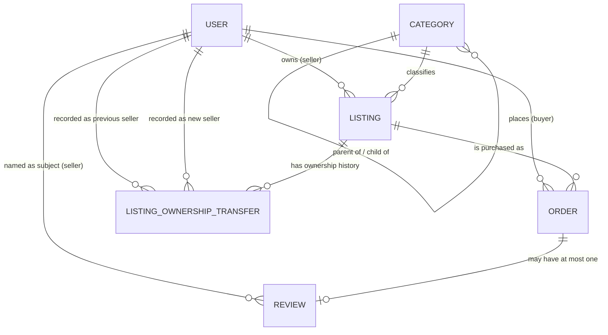
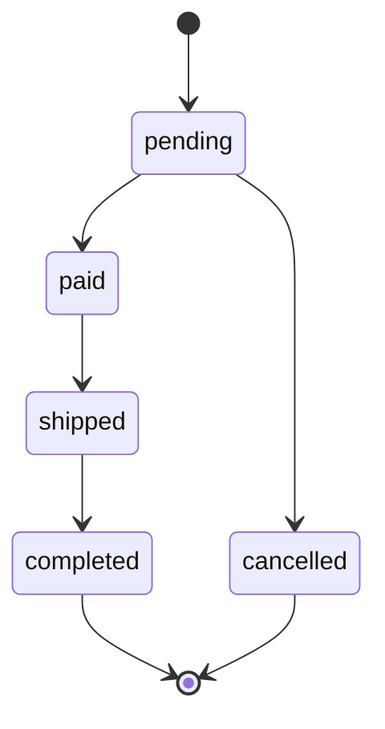

# EKE (market day) — API Design & Data Model

Project name (filesystem): `eke-market-day`
App display name (in-app branding, page title, header): **EKE (market day)**
Revision: Rev 0.2 — Part A (written design, revised for the confirmed
ListingOwnershipTransfer design, Category in the minimum entity set, and the
mandatory money CHECK) · 2026-09-23

> **Document choice.** This design lives in a single `DOCUMENTATION.md`
> rather than a separate `REQUIREMENTS.md`. Step 1 (Requirements) is kept
> as its own clearly delimited section below; keeping every section in one
> file makes the whole design reviewable in one pass. If the reviewer
> prefers `REQUIREMENTS.md` as a standalone artifact, Step 1 is two
> copy-pastes away and stands on its own.
>
> **Status.** PART A (Steps 1–4) is complete and is the deliverable of this
> revision. Step 5 (schema, migration, seed, five proof queries, the
> confirmed 6th, bonus ownership-transfer query, and three invalid-insert
> tests) is a direct, faithful translation of what is decided below and is
> intentionally NOT started until Part A is approved.

---

## Key decisions at a glance

These five branching decisions are argued in detail in their sections; the
one-line version is here so a reviewer can spot them fast.

1. **One order = one listing.** An order purchases exactly one listing,
   never a cart. If the product later grows a cart, the exact, stated
   evolution is a separate `OrderItem` model with per-line snapshots
   (swap-out note in Step 2).
2. **A user can be buyer, seller, or both.** Modeled as two independent
   boolean flags (`isBuyer`, `isSeller`) with a CHECK that at least one is
   true — not a mutually exclusive `role` enum.
3. **Reviews are about the seller, one per order.** A review belongs to a
   completed order, is written by that order's buyer, and its subject is
   the seller (not the listing). `orderId` is `UNIQUE` so the database
   itself enforces at most one review per order.
4. **Orders snapshot the listing at purchase time.** `priceMinorAtOrder`,
   `currencyAtOrder`, `titleAtOrder`, and `shippingAddressAtOrder` are
   copied onto the order when it is placed, so later edits to the listing
   can never rewrite what the buyer actually agreed to.
5. **Seller-of-order is historical, via a real `ListingOwnershipTransfer`
   history table — not a direct snapshot onto Order and not a live lookup.**
   Every ownership change writes a transfer row FIRST (listingId,
   previousSellerId, newSellerId, transferredAt), then updates
   `Listing.sellerId`. An order's true seller is the one who owned the
   listing at the moment the order was placed, resolved by the
   transfer-window lookup; deliberately chosen over the simpler snapshot
   because it preserves the full ownership history as its own real feature,
   at the real cost of a more complex lookup query.

---

## Step 1 — Requirements

### What the product does

EKE (market day) is a two-sided marketplace. Sellers publish listings for
goods; buyers purchase listings; every purchase follows a fixed lifecycle
from *placed* to *paid* to *shipped* to *completed*; and a completed
purchase is the only thing that can generate a review. The product is
bulletproof about one thing above all: what a buyer actually agreed to pay
is frozen at the moment of purchase and can never be silently changed by a
seller later editing the listing. Who that seller *was*, for any given
order, is likewise a historical fact that survives later changes of
ownership (see the ListingOwnershipTransfer decision in Step 2).

### Who uses it

- **Sellers** — list goods, control their own listings, and fulfill the
  orders placed against them.
- **Buyers** — place orders, and review the seller after a completed order.
- A single account may be **both** a buyer and a seller; the model permits
  this explicitly (two independent capability flags, at least one set).

### The five most important actions a user takes

Every later design decision in this document traces back to one of these
five (the index in Step 3, question 7, exists purely to serve them):

1. **A seller creates a listing** (posts an item for sale).
2. **A buyer places an order** (commits to buy, at the snapshot price).
3. **A seller marks an order shipped** (fulfills an order against their
   listing).
4. **A buyer leaves a review after a completed order** (feedback on the
   seller, once per order).
5. **A buyer or seller views their own order history** (the buyer's
   purchases or the seller's fulfilled-and-open pipeline).

Nothing else is required for a user to get value from the product; this is
the whole job.

---

## Step 2 — Entities and Relationships

### Identifier shape — all entities

Every primary key is a **generated, never-sequential** identifier: a
21-character Prisma `cuid`. No `SERIAL`/`BIGSERIAL`, no `IDENTITY`, no
sequential value of any kind anywhere in the schema — including
`ListingOwnershipTransfer.id`. The real reason is a security one and is
argued in Step 3, question 5 (enumeration risk). A separate, human-facing
`Order.orderCode` is also non-sequential (see Order below). Foreign keys
share the same `String` shape as their target.

### Entity: `User`

One-sentence description: an account that can buy, sell, or both.

```prisma
model User {
  id        String    @id @default(cuid())
  email     String    @unique
  fullName  String
  isBuyer   Boolean   @default(false)
  isSeller  Boolean   @default(false)
  createdAt DateTime  @default(now())
  updatedAt DateTime  @updatedAt
  deletedAt DateTime?

  listings      Listing[] @relation("SellerListings")
  orders        Order[]   @relation("BuyerOrders")
  reviews       Review[]  @relation("ReviewSubject")
  previousSales ListingOwnershipTransfer[] @relation("PreviousSeller")
  newSales      ListingOwnershipTransfer[] @relation("NewSeller")
}
```

- `deletedAt` = soft delete (policy in Step 3, question 4). Nullable → active;
  present → deactivated.
- Constraint `CHECK (isBuyer OR isSeller)` added in the migration: an
  account that is neither a buyer nor a seller is impossible. Being both is
  explicitly allowed — the flags are independent, not a mutually exclusive
  `role`.
- No public "list all users" endpoint exists (see API Step 4) — bulk
  enumeration of user records is a privacy anti-pattern, which is the same
  reasoning driving non-sequential identifiers.

### Entity: `Category`

One-sentence description: a browseable grouping for listings, organized as
a parent/child tree (self-referential); a real entity in the minimum set,
referenced by Listing.

```prisma
model Category {
  id        String         @id @default(cuid())
  name      String         @unique
  parentId  String?
  parent    Category?      @relation("CategoryTree", fields: [parentId], references: [id])
  children  Category[]     @relation("CategoryTree")
  listings  Listing[]
  createdAt DateTime       @default(now())
  updatedAt DateTime       @updatedAt
  deletedAt DateTime?

  @@index([parentId])
}
```

- Self-referential one-to-many: a category has many child categories;
  every category has at most one parent; a `parentId = null` row is a root.
- `name` is globally unique — two categories with the same name are
  impossible.
- `parentId` is nullable because a top-level category (e.g. `Produce`)
  has no parent at all — only a sub-category (e.g. `Yam` under `Produce`)
  sets it. This is a real, distinct pattern from every other foreign key in
  this schema and is worth naming explicitly: the FK points back into its
  **OWN** table, not a different one.
- The database can prevent *dangling* parents (the FK) and a row being its
  own parent (`CHECK (id <> parentId)` in the migration) but **cannot**,
  with a plain CHECK, prevent a cycle across rows (`A → B → A`). Cycle
  prevention is honestly app-level in Step 3, question 6.

### Entity: `Listing`

One-sentence description: an item a seller has put up for sale, belonging
to exactly one seller and one category.

```prisma
model Listing {
  id          String   @id @default(cuid())
  sellerId    String
  seller      User     @relation("SellerListings", fields: [sellerId], references: [id])
  categoryId  String
  category    Category @relation(fields: [categoryId], references: [id])
  title       String
  description String
  priceMinor  Int      // 150000 = ₦1,500.00 — whole kobo/cents, see Step 3 Q2
  currency    String   @default("NGN")
  status      String   @default("active")  // CHECK ('active','sold','removed')
  imageUrls   String[] @default([])        // Postgres text[]; URLs only, no entity
  createdAt   DateTime @default(now())
  updatedAt   DateTime @updatedAt
  deletedAt   DateTime?

  ownershipTransfers ListingOwnershipTransfer[]

  @@index([sellerId])
  @@index([categoryId])
}
```

- A listing is a single, real offer. `priceMinor`/`currency` are the only
  canonical home of "what this costs right now" (Step 3, question 1).
  `Listing.sellerId` is the canonical home of "who owns this listing
  **right now**" — the *present* owner, not the historical one (the
  historical one lives in ListingOwnershipTransfer, below).
- `imageUrls` is a multi-valued scalar (`String[]`) deliberately NOT a
  separate `Image` entity: a URL has no attributes worth modeling, and an
  entity table just to hold strings is ceremony. A dedicated media service
  is out of scope; the array carries metered URLs only.
- `status` CHECK: an order may only be placed against an `active` listing
  (argument in Step 3, question 3).
- Soft-delete policy is load-bearing for the transfer history: listings are
  referenced by ListingOwnershipTransfer.listingId (Step 3, question 4).

### Entity: `ListingOwnershipTransfer`

One-sentence description: an append-only record of a listing changing
hands — written FIRST, before `Listing.sellerId` itself is updated — the
permanent audit trail from which an order's true, historical seller is
derived (confirmed decision; this is a real part of the minimum entity
set, not an afterthought).

```prisma
model ListingOwnershipTransfer {
  id               String   @id @default(cuid())
  listingId        String
  listing          Listing  @relation(fields: [listingId], references: [id])
  previousSellerId String
  previousSeller   User     @relation("PreviousSeller", fields: [previousSellerId], references: [id])
  newSellerId      String
  newSeller        User     @relation("NewSeller", fields: [newSellerId], references: [id])
  transferredAt    DateTime @default(now())

  @@index([listingId, transferredAt])
}
```

- **Write-first discipline:** every ownership change writes a transfer row
  in the same transaction as — and before — the `Listing.sellerId` update.
  The trail is dependable only if the history precedes the present; this
  ordering is enforced at the application layer (Step 3, question 6 states
  the honest boundary of what the database alone guarantees).
- **The lookup this enables:** to find the true, historically-correct
  seller of an order, find the transfer row for that listingId whose
  `transferredAt` window actually contains the order's own `createdAt`
  (the seller who owned the listing at the moment this specific order was
  placed, not whoever owns it today). The exact query lives in Step 3,
  question 1; the composite `(listingId, transferredAt)` index serves it
  (Step 3, question 7).
- This is a deliberate, considered choice over the simpler alternative —
  snapshotting sellerId directly onto Order like D1 does for price/title —
  because it costs real query complexity but genuinely preserves full
  ownership history as its own, real feature, not just "who sold this one
  order." The reasoning is stated in full in Step 3, question 1.
- Final state note: the mechanism depends on both `User` and `Listing`
  rows persisting (their soft-delete decisions are load-bearing — Step 3,
  question 4).

### Entity: `Order`

One-sentence description: a buyer's purchase of exactly one listing, with
the agreed price, title, and shipping target frozen at purchase time, and
whose seller — never stored on the order — is the seller who owned the
listing at the moment this order was placed, resolved via the
ListingOwnershipTransfer history (not a simple, always-live lookup).

```prisma
model Order {
  id                       String   @id @default(cuid())
  orderCode                String   @unique // "EKE-8F3K2X9Q", non-sequential
  buyerId                  String
  buyer                    User     @relation("BuyerOrders", fields: [buyerId], references: [id])
  listingId                String
  listing                  Listing  @relation(fields: [listingId], references: [id])
  // — Deliberate denormalization (snapshot), see Step 3 Q1 (D1) —
  titleAtOrder             String
  priceMinorAtOrder        Int
  currencyAtOrder          String   @default("NGN")
  shippingAddressAtOrder   String
  status                   String   @default("pending") // CHECK set, state machine in Q3
  createdAt                DateTime @default(now())
  updatedAt                DateTime @updatedAt
  // no deletedAt — Orders are never hard- or soft-deleted (audit, disputes)

  review   Review?
  @@index([buyerId, status])
  @@index([listingId])
}
```

**Decision — one order purchases exactly one listing.** An order is a
single-item purchase, never a cart. Real justification: in a market-day
marketplace people haggle and buy item-by-item; each listing is an
individual, one-of-a-kind offer rather than a stocking SKU; and a
single-listing order keeps the fulfillment model simple — one shipment,
one address, one seller-at-the-time per order. If the product ever grows
carts, the named, faithful evolution is a separate `OrderItem` model
(`orderId`, `listingId`, plus per-line `titleAtOrder`/`priceMinorAtOrder`/
`currencyAtOrder` snapshots) and the Order-level snapshot fields move down
one level — exactly the swap the brief itself suggests; that is stated now
so the later migration is a known shape, not a redesign.

- The **seller of an order is never stored** on `Order`, and it is NOT a
  simple live lookup on `Listing.sellerId` (that would answer "who owns it
  today", which may be wrong). It is always resolved through the
  `ListingOwnershipTransfer` history: the seller who owned the listing at
  this order's own `createdAt` (Step 3, question 1 shows the exact query).
  Because the fact is not stored on the row, it is *unrepresentable* for
  the stored order to name the wrong seller; the historical one can always
  be looked up, even after the listing changes hands.
- `orderCode` is the human-facing reference ("EKE-8F3K2X9Q") customers and
  support use in disputes. It is random (base-32 of 8 bytes of
  CSPRNG output), never sequential, and unique — it exists so humans can
  refer to an order without reading out a 25-character cuid.
- `updatedAt` only moves on author actions; pure state transitions are the
  only writer.

### Entity: `Review`

One-sentence description: rating + comment about a **seller**, written by
the **buyer** of a specific **completed** order — at most one per order.

```prisma
model Review {
  id             String   @id @default(cuid())
  orderId        String   @unique // at most one review per order — DB-enforced
  order          Order    @relation(fields: [orderId], references: [id])
  sellerId       String            // subject — deliberate denormalization, see Q1 (D2)
  seller         User     @relation("ReviewSubject", fields: [sellerId], references: [id])
  rating         Int               // CHECK 1 <= rating <= 5
  comment        String?
  sellerResponse String?
  createdAt      DateTime @default(now())
  updatedAt      DateTime @updatedAt
  deletedAt      DateTime?

  @@index([sellerId])
}
```

**Decision — a review is about the seller, not the listing.** Real
justification: (a) market-day trust is fundamentally seller-trust — the
buyer deals with a specific person whose goods may be misrepresented;
(b) because one order buys exactly one listing, "about the seller" is
unambiguous — and that seller is the *historical* seller of the order,
resolved via the ListingOwnershipTransfer lookup, the person actually being
judged for this transaction;
(c) reviews-about-the-listing would mean two review slots per transaction,
doubling spam surface and complicating the single "one review per order"
rule. Product-quality signal, if ever wanted, belongs to a future
separate listing-rating model — deliberately out of scope now.

- The **author is never stored** on `Review`. It is derived
  `Review.orderId → Order.buyerId`. Same reason as an order's seller: "who
  wrote this" is a fact of the order and storing a second copy would let
  the two disagree.
- `sellerId`, the **subject**, is the exception: it is deliberately pinned
  (denormalization D2, argued in Q1) — the historical seller, resolved at
  review creation and frozen, so the review always names the exact person
  who fulfilled that order.
- `sellerResponse` is set by the order's true historical seller (enforced
  app-side; there is no post-seller in the schema).
- FK alone stops "review of a nonexistent order"; `UNIQUE(orderId)` also
  stops "two reviews of the same order"; the "order must be completed"
  rule needs app logic (honest statement in Step 3, question 6).

### Relationship & cardinality summary

| # | From | To | Cardinality | Meaning |
|---|------|----|-------------|---------|
| 1 | `User` (seller) | `Listing` | 1 — N | a seller owns many listings; each listing has exactly one current seller |
| 2 | `User` (buyer) | `Order` | 1 — N | a buyer places many orders; each order has exactly one buyer |
| 3 | `Category` | `Category` | 1 — N (self) | a category has many children; each child has at most one parent |
| 4 | `Category` | `Listing` | 1 — N | a listing belongs to exactly one category; a category holds many listings |
| 5 | `Listing` | `Order` | 1 — N | a listing can be referenced by many orders over time; each order references exactly one listing |
| 6 | `Order` | `Review` | 1 — 0..1 | an order has at most one review (`UNIQUE(orderId)`); a review belongs to exactly one order |
| 7 | `Review` | `User` (seller) | N — 1 | a review names exactly one seller; a seller can be named in many reviews |
| 8 | `Listing` | `ListingOwnershipTransfer` | 1 — N | a listing can change hands many times; each transfer row belongs to exactly one listing |
| 9 | `User` (previous seller) | `ListingOwnershipTransfer` | 1 — N | a user can be the previous seller of many transfers |
| 10 | `User` (new seller) | `ListingOwnershipTransfer` | 1 — N | a user can be the new seller of many transfers |



> **Diagram note — real artifact still required.** The Mermaid source above
> is a genuine tool-made diagram definition, but the brief's evidence rule
> asks for the *rendered* artifact. I can produce the source, not the
> physical/exported rendering or a hand drawing — a rendered/exported
> version (PNG/SVG export of this diagram, or a photographed hand-drawn
> one) is still needed from the user / their tooling before the evidence
> checklist is satisfied. Same applies to the Order state machine in
> Step 3, question 3. Nothing else in this document is missing — only the
> two rendered diagrams.

---

## Step 3 — The Seven Hard Questions

### 1. Normalization — where does each fact live, once, canonically?

**The rule.** Every fact has exactly one canonical home; anything not
canonical is a *derived* value (computed at read time) or an explicitly
justified snapshot (computed at write time and frozen), never a second
writable copy of the same fact.

Canonical homes (non-exhaustive, the load-bearing ones):

| Fact | Canonical column(s) | Everything else derives from |
|------|--------------------|------------------------------|
| What a listing costs right now | `Listing.priceMinor`, `Listing.currency` | — |
| Who owns a listing **right now** | `Listing.sellerId` | the current owner attribution for browsing/placement |
| The full ownership history of a listing | `ListingOwnershipTransfer` rows (listingId, previousSellerId, newSellerId, transferredAt) | an order's **true historical seller** derives here |
| Who an order belongs to | `Order.buyerId` | a review's author derives here |
| What categories exist | `Category.id`, `Category.parentId` | the tree |
| How the buyer rated the seller | `Review.rating`, `Review.sellerId` | — |

Deliberately derived, never stored:

- **An order's true, historical seller.** Derived from the ownership
  history, NOT from today's `Listing.sellerId` and NOT stored on the
  order. The real query (exactly the pattern settled in the combined
  file's Part 3 SKILL):

  ```sql
  SELECT COALESCE(
    (SELECT "newSellerId" FROM "ListingOwnershipTransfer"
     WHERE "listingId" = $1 AND "transferredAt" <= $2
     ORDER BY "transferredAt" DESC LIMIT 1),
    (SELECT "sellerId" FROM "Listing" WHERE "id" = $1)
  ) AS historical_seller_id;
  -- $1 = the order's listingId, $2 = the order's own createdAt.
  -- Falls back to Listing.sellerId directly if no transfer ever
  -- happened (the common case: most listings never change hands).
  ```

  The subquery takes the newest transfer *at or before* the order's
  timestamp; the fallback keeps the common case a single indexed Listing
  read. (argued in Step 2, Order)
- **A review's author** is derived `orderId → Order.buyerId`. (argued in
  Step 2, Review)

**Seller identity is deliberately NOT denormalized — the confirmed answer
is a real ownership-history table.** "Where does the canonical fact of
who-sold-this-order live?" lives in `ListingOwnershipTransfer`, and this
choice is distinct from the D1 price/title snapshot, so the reasons are
stated separately and honestly:

- **Why not the simpler snapshot alternative (D1-style sellerId on
  Order)?** A snapshot preserves exactly one fact — "who sold this one
  order" — and throws the rest away. The confirmed design instead keeps
  that fact *and* the story around it: the marketplace can answer
  "who has owned this listing, and when" forever, as its own real feature
  (seller-activity records, dispute forensics, transfer history) — not
  just "who sold this one order."
- **Why not a simple, always-live lookup on `Listing.sellerId`?** At
  order-resolution time that is the *wrong* answer as soon as a listing
  changes hands after the order was placed: it returns whoever owns the
  listing today ("today's owner at reading time") instead of the seller at
  the moment the order was actually created.
- **The real cost, stated plainly:** resolving the historical seller is a
  real query — a time-window match — where a snapshot would be a column
  read. That cost is bounded two ways: by the composite
  `(listingId, transferredAt)` index (question 7), and by the COALESCE
  fallback, which keeps the overwhelmingly common case (a listing that
  never changed hands) at a single indexed Listing read.
- **What makes the trail dependable:** the write-first discipline — the
  transfer row is inserted in the same transaction as — and before — the
  `Listing.sellerId` update (Step 2, ListingOwnershipTransfer; enforcement
  boundary stated in question 6).

**Two places worth the deliberate denormalization.**

**D1 — Order snapshots the listing's price, currency, title, and shipping
address at purchase time.** The buyer agreed to *that* price for *that*
title on *that* day sent to *that* address. If the seller edits the listing
afterward — raises the price, rewrites the title, removes the listing
entirely — the order column must still say exactly what was agreed, or
disputes, refunds, and regulatory records become unknowable months later.
The snapshot is written once, in the same transaction that creates the
order, from the listing row, by the server — never supplied by the client
(even a well-behaved client could hold a stale price; a hostile one could
underquote). This is the standard, correct marketplace choice and is why
the schema keeps plain FKs to the listing while carrying the frozen
copies beside them. (Note the deliberate contrast with seller identity:
price/title ARE snapshotted, because a historical *contract* needs a
frozen copy; seller identity is NOT snapshotted, because an *identity
history* is itself the feature — argument above.)

**D2 — Review pins `sellerId`, its subject, though it is derivable.** The
seller named by a review is the seller who owned the listing *at the
moment the order was placed* — resolved through the same
ListingOwnershipTransfer window lookup as the order's own seller (above),
not whoever owns the listing today — and that resolved historical seller
is pinned onto the review row at creation. Reasons: a review is a durable
public statement *about* one specific person; its subject should be
explicit, queryable without a two-hop join on every seller-profile access,
and frozen forever so it cannot silently become someone else when a
listing changes hands after the fact. "All reviews for seller X" is then a
single indexed `WHERE sellerId = ?`. This is denormalization of a
*derived* fact with a stated reason, which is exactly the standard Q1
asks for.

**What we deliberately do NOT denormalize, on purpose.** No running
counters on the seller (e.g. `soldCount`, `ratingAvg`, `totalTransfers`).
Counters drift — every write to `Order.status` or `ListingOwnershipTransfer`
would have to maintain them or they silently lie. Aggregation over the
indexed columns above is cheap at this scale; if a counter is ever needed
it becomes a maintained/projected view with its own tests, not a column.
Same for search/de-normalized text: title search is app-side over
`title`/`description`; a search engine (one denormalized document store)
is an explicitly future decision.

### 2. Money — every amount is a whole integer in minor units, with a currency column beside it

**The invariant.** Every monetary value in the system is a **signed whole
integer in the currency's minor units** — 100 kobo = ₦1.00, 100 cents =
$1.00 — stored in a 4-byte `Int`, with an ISO 4217 currency code stored in
the **same row**, immediately beside the amount. Applied everywhere money
appears:

- `Listing.priceMinor` + `Listing.currency` (default `"NGN"`)
- `Order.priceMinorAtOrder` + `Order.currencyAtOrder` (default `"NGN"`) —
  the only other money; the snapshot keeps its own copy of the currency so
  the money value is fully self-describing and can't be misread even if the
  listing's currency context later changes.

**Real justification:** binary floats can't represent 0.1 exactly, and
accounting errors that accumulate over kobo-level buys are the kind of bug
that erodes trust in a marketplace faster than any feature. An integer
minor-unit column is exact for addition, sequence is lossless, and the DB
type documents intent. Formatting (`₦1,500.00`), locale, and decimal
placement are purely presentation-layer concerns that never touch storage.
The 4-byte ceiling is ~21.4 million major units of NGN — comfortably above
any real listing here; the note is recorded so a future exchange-rate or
high-value table knows to reach for `BigInt`/`Decimal` deliberately.

**The `CHECK >= 0` guard is REQUIRED, not optional.** A negative price or
a negative order total is a genuinely invalid, real-world-impossible
state, and the database itself must make it impossible — not just the
application layer. Prisma's schema syntax alone cannot express a CHECK
constraint, so this is a real raw-SQL migration addition, the same pattern
as the state-machine constraint below, with the exact constraint names
settled in the combined file's Part 3 SKILL:

```sql
ALTER TABLE "Listing" ADD CONSTRAINT price_non_negative
  CHECK ("priceMinor" >= 0);
ALTER TABLE "Order" ADD CONSTRAINT order_price_non_negative
  CHECK ("priceMinorAtOrder" >= 0);
```

- The `Listing` CHECK means a listing can never be posted at a negative
  price, or even a price the DB has to guess at.
- The `Order` CHECK means an order can never record a negative agreed
  price. This is also deliberately invalid-insert test #3 in Step 5: that
  test is REQUIRED to be rejected by this exact constraint, not an
  optional case.

Currency membership is validated app-side against an ISO 4217 allow-list
for v1 (only `NGN` is actually supported), rather than as a CHECK that
hard-codes a single value into the database.

### 3. Status and state machines

**`Order.status`** — lifecycle over: `pending`, `paid`, `shipped`,
`completed`, `cancelled`.



| Current | Allowed → | Forbidden → (with why) |
|---------|-----------|------------------------|
| `pending` | `paid`, `cancelled` | `shipped`/`completed` (skips payment); anything else |
| `paid` | `shipped` | `pending` (backwards — a paid order cannot become unpaid); `cancelled` (cancelling after money moves requires a refund flow, which is explicitly out of scope, so it is not a status transition); `completed` (skips fulfillment) |
| `shipped` | `completed` | `paid`/`pending` (backwards, buyer already sent); `cancelled` (needs a return flow, out of scope) |
| `completed` | (none) | **every** thing — a terminal commercial record; notably `completed → pending` is the combined brief's own forbidden example |
| `cancelled` | (none) | every thing — terminal, notably `cancelled → completed` |

**What enforces this.** Split enforcement, stated plainly and honestly:

- The **value set itself** is a database CHECK constraint in the migration:
  `CHECK (status IN ('pending','paid','shipped','completed','cancelled'))`.
  The database will never hold an unknown status, no matter what calls it.
- The **transitions between values** are application-level: the service
  method that moves an order loads the row, checks `(current, next)` against
  the table above, and raises `state_conflict` otherwise. This is a real
  limitation of a CHECK constraint — it validates one row's current value,
  not a change from one value to another across an UPDATE — and the brief
  insists we say so rather than overclaim. A DB trigger could also enforce
  transitions, but duplicating the order lifecycle in SQL (plus writing and
  testing a trigger for every new rule) is worse than one well-tested
  domain method; the CHECK for the value-set stays in the DB, the policy
  logic stays in the application, and that split is the decision.

**`Listing.status`** — same pattern, smaller: values `active`, `sold`,
`removed` via CHECK; transitions `active → sold`, `active → removed`,
both terminal, enforced app-side. `removed` is a soft state (the row
survives for order-history integrity, it just isn't purchasable).

### 4. Time — `createdAt`/`updatedAt` everywhere, and a per-entity delete policy

**Baseline enforced for every entity:** `createdAt DateTime @default(now())`
and `updatedAt DateTime @updatedAt`. Timestamps are `timestamptz`,
stored in UTC; timezone rendering is presentation-only.

**One conscious, documented exception:** `ListingOwnershipTransfer` is an
append-only audit row and carries only `transferredAt` (the confirmed
schema in the combined file). That timestamp IS its clock: the row is the
event, writes are insert-only, so an `updatedAt` could never change, and a
separate `createdAt` would be redundant with `transferredAt`. This is an
explicit exception to the baseline, stated rather than silently omitted.

Per-entity delete policy, and the real compliance/audit reasoning:

| Entity | Policy | Why |
|--------|--------|-----|
| `User` | Soft delete (`deletedAt`) | First reason, general compliance: orders, listings, and reviews reference users; hard-deleting a user would cascade-destroy transaction history and dispute evidence. **Second, load-bearing reason specific to this design:** `ListingOwnershipTransfer.previousSellerId`/`newSellerId` hard-reference `User` rows. If a User were ever genuinely hard-deleted, those historical references would break, and the true, historical seller of an old order could no longer be looked up. User soft-delete is now a structural requirement of the ownership-history mechanism, not just an audit nicety. Full GDPR-style erasure is a separate, restricted, anonymizing flow (rows retained with identity scrubbed). |
| `Listing` | Soft delete (`deletedAt`, plus `status = 'removed'`) | Referenced by FK from orders AND by `ListingOwnershipTransfer.listingId`; the ownership-history mechanism depends on listing rows persisting. The D1 snapshot means hard-deleting a listing would not corrupt order amounts — but the `RESTRICT` FKs mean a listing with any order or any transfer row cannot be hard-deleted by the database anyway. Soft delete is the design that lets old listings vanish from the catalog while the rows that make history valid keep existing. |
| `Order` | **Never deleted.** No `deletedAt`, no DELETE path in the schema or writer. | Orders are the primary records for disputes, refunds, tax, and audit. This is not a feature decision, it's a books-and-records decision: the marketplace's own history is made of rows that, by design, cannot disappear. |
| `Review` | Soft delete (`deletedAt`, moderation/recounting visibility only) | A hard-deleted review would silently change a seller's review surface and destroy evidence in a dispute. Soft delete keeps the row and lets a "hidden" state be applied; hide, never erase. Content is editable by its author through an app window only — raw feedback integrity beats edit-anything. |
| `Category` | Soft delete (`deletedAt`) | Referenced by listings via `RESTRICT` FK; a hard delete would either be rejected or force-broken listings. Soft delete preserves the listing→category history and just stops new listings from targeting it. |
| `ListingOwnershipTransfer` | **Never deleted.** Append-only audit log; no `deletedAt`, no DELETE path. | It IS the history. Deleting a transfer row would destroy the mechanism's own record and break historical-seller resolution for every order in that window. This table is the strongest "never delete" case in the schema. |

### 5. Identifiers — generated, never sequential

**Every primary key is a generated cuid.** No `SERIAL`, no auto-increment,
no sequential integer anywhere — including `ListingOwnershipTransfer.id`.
Same for `Order.orderCode`, which humans read: `"EKE-"` + 8 random
Crockford base-32 characters from a CSPRNG, not `#4021`.

**The real, security reason.** Sequential identifiers are enumerable. If
orders were `id = 4021`, a client that owns one order can walk `4020`,
`4022`, `4019`… and harvest other customers' titles, addresses, and prices
— the exact data this marketplace is meant to keep private — by doing
nothing more than incrementing integers, and bots can scrape an entire
catalog the same way. Unpredictable, unguessable ids raise the cost of that
attack from "free" to "impractically large", behind whatever access control
layer comes later. The tradeoff (non-sequential ids are slightly less
convenient to read and index slightly less compactly than a 4-byte int) is
paid gladly; this is the difference between "the ids leak nothing" and
"the ids are a directory."

Because ids are non-sequential, **cursor/keyset pagination** is the only
consistent pagination (Step 4) — there is no meaningful numeric offset to
seek against, which is a feature, not a limitation.

### 6. Constraints — per table, and the impossible state each one forbids

A constraint's value in this design is not that it exists; it is the
specific real-world-impossible state the database itself can now never
hold. Named column-wise:

#### `User`
| Constraint | The impossible state it forbids |
|------------|--------------------------------|
| `PRIMARY KEY (id)` | two users with the same id / a user with no identity |
| `UNIQUE (email)` | two accounts sharing one email, or one account re-registering the same email |
| `CHECK (isBuyer OR isSeller)` | an account that is neither buyer nor seller (dead weight account) |
| NOT NULL on email, fullName | a user without an identity or a handle |

#### `Category`
| Constraint | The impossible state it forbids |
|------------|--------------------------------|
| `PRIMARY KEY (id)` + `UNIQUE (name)` | two categories with the same name |
| `FOREIGN KEY (parentId) → Category.id` (RESTRICT) | a child whose parent doesn't exist |
| `CHECK (id <> parentId)` | a category that is its own parent |
| — | cross-row cycles (`A→B→A`) are NOT blocked by any plain CHECK; honestly app-guarded (or later a trigger) because Postgres CHECKs see one row at a time |

#### `Listing`
| Constraint | The impossible state it forbids |
|------------|--------------------------------|
| `PRIMARY KEY (id)` | duplicate listings |
| `FOREIGN KEY (sellerId) → User.id` (RESTRICT) | a listing with no real current owner (and no deleting a user who still owns listings — history preserved) |
| `FOREIGN KEY (categoryId) → Category.id` (RESTRICT) | a listing in a nonexistent category; no deleting a category that still classifies listings |
| `CHECK (priceMinor >= 0)` (named `price_non_negative` in the migration) | a negative-priced listing — REQUIRED (Q2), not optional |
| `CHECK (status IN ('active','sold','removed'))` | a listing with a status no buyer or system knows how to mean |
| NOT NULL on title, description, currency | a listing missing things every listing must have |

#### `ListingOwnershipTransfer`
| Constraint | The impossible state it forbids |
|------------|--------------------------------|
| `PRIMARY KEY (id)` | two transfer rows with the same id / a transfer with no identity |
| `FOREIGN KEY (listingId) → Listing.id` | an ownership record pointing at a **listing that was never real** |
| `FOREIGN KEY (previousSellerId) → User.id` | a transfer record naming a **previous seller who was never a real user** |
| `FOREIGN KEY (newSellerId) → User.id` | a transfer record naming a **new seller who was never a real user** |
| `CHECK (previousSellerId <> newSellerId)` | a "transfer" where the owner did not change — a no-op whose three columns are identical is meaningless as an event |
| — | time-ordered, non-overlapping windows per listing are NOT guaranteed by plain CHECKs; write-first ordering and single-threaded transfer transactions are enforced at the application layer (per the confirmed write-first rule) |

#### `Order`
| Constraint | The impossible state it forbids |
|------------|--------------------------------|
| `PRIMARY KEY (id)` + `UNIQUE (orderCode)` | duplicate orders / duplicate human references |
| `FOREIGN KEY (buyerId) → User.id` | an order with no real buyer |
| `FOREIGN KEY (listingId) → Listing.id` | an order referencing a **nonexistent listing** — invalid-insert test #2 in Step 5, rejected by the database itself |
| `CHECK (status IN ('pending','paid','shipped','completed','cancelled'))` | an order in a made-up commercial state (Q3) |
| `CHECK (priceMinorAtOrder >= 0)` (named `order_price_non_negative` in the migration) | an order recording a negative agreed price — REQUIRED (Q2); invalid-insert test #3 in Step 5, rejected by the database itself |
| NOT NULL on the four snapshot columns | an order without a price / title / currency / destination = an order without a contract |
| no `sellerId` column at all | "the order's seller disagrees with the ownership history" is **unrepresentable** — the true seller is resolved from ListingOwnershipTransfer (Q1), so there is no stored column that could hold the wrong answer |

#### `Review`
| Constraint | The impossible state it forbids |
|------------|--------------------------------|
| `PRIMARY KEY (id)` | duplicate reviews |
| `FOREIGN KEY (orderId) → Order.id` | a **review with no order** — invalid-insert test #1 in Step 5 |
| `UNIQUE (orderId)` | two reviews for the same order (double-dipping a transaction for reputation) — the database, not the app, owns this |
| `FOREIGN KEY (sellerId) → User.id` | a review judging a nonexistent seller |
| `CHECK (rating BETWEEN 1 AND 5)` | a rating of 0 or 6 or 100 — the DB refuses out-of-range reputation |
| NOT NULL on rating | a review with no verdict |
| — | "the order must be `completed` before a review exists" is NOT enforceable by these constraints alone: the FK confirms the order *exists*; nothing in a plain CHECK can inspect the *referenced* order's status. That gate is application logic at insert time, stated honestly now and enforced there (Step 4 `POST /orders/{id}/review`), unless a real trigger is later built |

Cross-row invariants that get an explicit "app-layer, not DB" label rather
than a false claim of DB enforcement: order state *transitions* (Q3),
review-requires-completed-order, category *cycles*, transfer-window
ordering on ListingOwnershipTransfer, and "the review author is the order's
buyer" (author isn't stored at all, so it can't diverge — see Q1).

### 7. Indexes — exactly the index the five important actions run on

For each important action, the canonical query it drives and the index that
serves it. (Foreign key columns get automatic indexes from Postgres/Prisma;
the named ones here are the deliberate, so-called *purpose-built* ones.)

| Action | Canonical query the action drives | Index that serves it |
|--------|-----------------------------------|----------------------|
| 1. Seller creates a listing | seller's own list view: `WHERE sellerId = ? ORDER BY createdAt DESC` | `Listing(sellerId)` (used with a `createdAt` sort, satisfied by an index scan + sort at this volume) |
| 2. Buyer places an order | snapshot read at commit: fetch the exact listing by id → `WHERE id = ?` | `Listing` PRIMARY KEY (the cuid B-tree is the index doing this work) |
| 3. Seller marks an order shipped | seller's fulfillment inbox: "my listings' orders, filtered by status" → `JOIN Listing ON Order.listingId = Listing.id WHERE Listing.sellerId = ? AND Order.status = ?` | `Listing(sellerId)` to constrain to the seller's listings, then `Order(listingId)` to fetch those listings' orders — two single-relation index joins; when a listing has changed hands, the true-seller check resolves through `ListingOwnershipTransfer(listingId, transferredAt)` below |
| 4. Buyer leaves a review after a completed order | "which of my orders are completed and still unreviewed?" → `WHERE buyerId = ? AND status = 'completed'` | composite `Order(buyerId, status)` — filters both predicates from one B-tree |
| 5. Buyer or seller views own order history | buyer: `WHERE buyerId = ? ORDER BY createdAt DESC`; seller: the same join shape as action 3 | `Order(buyerId, status)` (also usable by `buyerId` alone, prefix) and, for the seller side, `Order(listingId)`; seller attribution across ownership changes likewise resolves through the transfer index below |

**ListingOwnershipTransfer's own core query — the historical-seller
lookup, and the index it depends on.** None of the five actions above is
"who was the true seller of this order", but the confirmed mechanism's
correctness depends on it, so it gets its own stated index rather than an
implicit one. Resolving the seller who owned a listing at a point in time
is the time-window search

```sql
WHERE "listingId" = $1 AND "transferredAt" <= $2
ORDER BY "transferredAt" DESC LIMIT 1
```

and the composite **`ListingOwnershipTransfer(listingId, transferredAt)`**
is exactly the index that serves it: it constrains to the listing by
`listingId`, then seeks the newest transfer at-or-before the order's
timestamp from the index order itself, without scanning the rest of the
transfer history for that listing. It is declared in the schema
(`@@index([listingId, transferredAt])`) and is verified by the sixth,
bonus query's real `EXPLAIN` output in Step 5. The FK columns
`previousSellerId`/`newSellerId` receive automatic indexes that serve "the
complete ownership history of this seller."

Supporting indexes stated once: `Review(sellerId)` (a seller profile's
"all my reviews", directly serving the review action's read side),
`Listing(categoryId)`, `Category(parentId)` (tree), plus the unique indexes
carrying constraints from Q6 (`User.email`, `Order.orderCode`,
`Review.orderId`). Step 5 verifies the two heaviest of these — action 3 and
action 5 — with real `EXPLAIN` output showing index scans, and will not
describe expected behavior as evidence.

---

## Step 4 — The API Design

### Conventions shared by every endpoint

- **Base + version:** `/api/v1` (URL-versioned; the version is discoverable
  in every path, and a breaking change is a new `v2`, never a silent shape
  change under the same URL).
- **Media type:** `application/json` in and out. Errors are
  **RFC 7807 `application/problem+json`**:
  `{ "type", "title", "status", "detail", "code", "instance" }`, one
  stable machine-readable `code` alongside the human `detail`.
- **Money over the wire:** prices are plain integers in minor units with a
  `currency` field beside them, exactly as stored. The client **never
  sends money** on order creation — the server snapshots from the listing
  (Q1, D1; a client-supplied price would be the classic pricing bug).
- **Pagination** (every list endpoint): cursor/keyset, never offset.
  Query params: `limit` (default 20, max 100), `cursor` (opaque server
  token encoding the `(createdAt, id)` keyset), `sort` (`createdAt|asc` /
  default `createdAt|desc`). Response envelope:
  `{ "data": [...], "pagination": { "nextCursor": "…", "hasMore": true } }`.
  Rationale: pages stay stable while rows are inserted/deleted under the
  reader (offset pages silently skip and duplicate), and it composes with
  non-sequential ids (Q5) where "page 5" has no natural meaning. `hasMore`
  is computed by fetching `limit + 1`, never a `COUNT(*)`.
- **Idempotency:** defaults below; order creation is the exception — it
  takes a client `Idempotency-Key` header and is deduped server-side
  (Stripe-style), because a retry after a lost response must not create two
  orders. Wherever a *constraint* already makes duplicates impossible
  (reviews), no key is needed and the doc says why.
- **Auth:** out of scope by design. "Seller of the listing", "the true,
  historical seller of the order", "order is yours" are expressed as the
  *authorization checks* the future auth layer must perform (403 rows
  below), and are listed so the contract is complete; not implemented in
  this phase.

### The five important actions — endpoints, shapes, errors, idempotency

#### Action 1 — A seller creates a listing

**`POST /api/v1/listings`** — not idempotent (each call creates a distinct
resource; a duplicated listing is benign, visible to its owner, and
removable).

Request body:
```json
{
  "title": "Hand-woven raffia basket",      // required
  "description": "…",                        // required
  "priceMinor": 150000,                      // required, int >= 0  (= ₦1,500.00)
  "currency": "NGN",                         // required, ISO 4217 allow-list
  "categoryId": "ck…",                       // required, must exist
  "imageUrls": ["https://…/basket-1.jpg"]    // optional
}
```
Response `201 Created`, `Location: /api/v1/listings/{id}`, body the created
Listing (all fields above plus `id`, `status: "active"`, timestamps).

| Error | Code | Status | When |
|-------|------|--------|------|
| `validation_error` | 400 | missing/blank title; missing description; `priceMinor` not an int or `< 0`; `imageUrls` not an array of URLs |
| `category_not_found` | 404 | `categoryId` has no row |
| `unsupported_currency` | 422 | currency not in the ISO allow-list |
| `insufficient_permissions` | 403 | caller is not allowed to list (future auth: must be `isSeller`) |

**Supporting Listing CRUD** (all on `/api/v1/listings`):

- `GET /api/v1/listings?categoryId=&status=active&priceMin=&priceMax=&sellerId=&limit=&cursor=&sort=` → 200 page. 400 if a filter value is unparseable. (Cursor pagination per convention.)
- `GET /api/v1/listings/{id}` → 200 Listing | `listing_not_found` 404. If hard-`deletedAt`/`removed`, still 404.
- `PATCH /api/v1/listings/{id}` → 200 updated Listing. Partial: title, description, priceMinor, currency, categoryId, imageUrls, status. Errors: 400, 404, 422. **Price edits here affect only future orders** — already-placed orders keep their snapshot (Q1, D1); this is the whole point of the design.
- `DELETE /api/v1/listings/{id}` → 204 (soft delete, the row survives). Second delete of an already-removed listing → `listing_not_found` 404. Idempotency note: `DELETE`/soft-delete is defined as remove-if-exists; the 404-on-second-call is the honest, observable contract.
- Ownership changes of a listing are represented by a written
  `ListingOwnershipTransfer` row (write-first, then `Listing.sellerId`),
  exposed as an internal/management operation — the confirmed mechanism,
  exercised by the seeded transfer in Step 5; no separate public listing
  endpoint is required for the five important actions.

#### Action 2 — A buyer places an order

**`POST /api/v1/orders`** — **idempotent**, via the required `Idempotency-Key`
header (a client-generated UUID). Mechanism: the server stores the key with
the created order; a retry with the same key + same method returns the
stored `201` response instead of creating a second order. This runs in one
transaction with the snapshot read, so a lost-response retry can never
double-order. A same-key-with-different-body is `idempotency_key_mismatch`.

Request body:
```json
{
  "listingId": "ckx…",            // required
  "shippingAddress": "…"          // required
}
```
The client sends **no money fields** — `priceMinorAtOrder`,
`currencyAtOrder`, `titleAtOrder`, and `orderCode` are written by the
server from the listing and its currency in the same commit (Q1, D1).

Response `201 Created`, `Location: /api/v1/orders/{id}`:
```json
{
  "id": "clo…",
  "orderCode": "EKE-8F3K2X9Q",
  "buyerId": "clu…",
  "listingId": "ckx…",
  "titleAtOrder": "Hand-woven raffia basket",
  "priceMinorAtOrder": 150000,
  "currencyAtOrder": "NGN",
  "shippingAddressAtOrder": "…",
  "status": "pending",
  "createdAt": "2026-09-23T…Z",
  "updatedAt": "2026-09-23T…Z"
}
```

| Error | Code | Status | When |
|-------|------|--------|------|
| `validation_error` | 400 | missing body fields; missing `Idempotency-Key` header |
| `listing_not_found` | 404 | `listingId` has no row (or is removed) |
| `listing_not_available` | 409 | listing exists but `status != 'active'` (sold/removed) — the order can't begin |
| `unsupported_currency` | 422 | listing currency not accepted |
| `idempotency_key_mismatch` | 409 | same key reused with a different body |
| `insufficient_permissions` | 403 | caller is not a buyer (future auth) |

**Supporting:** `GET /api/v1/orders/{id}` → 200 order | `order_not_found`
404. `GET /api/v1/orders/{id}` history links below.

#### Action 3 — A seller marks an order shipped

**`POST /api/v1/orders/{id}/ship`** — explicit command endpoints instead of
a generic `PATCH /status`, because a state machine deserves named,
validated moves; the transition table from Q3 is checked app-side before
any write. Idempotent-as-no-op: shipping an already-`shipped` order returns
`200` with the unchanged order (the operation's effect has already been
applied; a retried response is safe). A transition that is *illegal at this
state* is a 409, not a silent no-op.

| Error | Code | Status | When |
|-------|------|--------|------|
| `order_not_found` | 404 | `{id}` has no row |
| `state_conflict` | 409 | current status makes shipping illegal per Q3 (e.g. `pending`, `completed`, `cancelled`) |
| `insufficient_permissions` | 403 | caller is not the order's **true, historical seller** — resolved via `ListingOwnershipTransfer` (Q1), the source of truth for who may fulfill; not whoever owns the listing today |

**`POST /api/v1/orders/{id}/cancel`** — same shape; `state_conflict`
unless current status is `pending`.

**Supporting:** `GET /api/v1/sellers/{sellerId}/orders?status=paid&limit=&cursor=` — the seller's fulfillment pipeline and history (this is also the seller half of action 5). 200 page, 400 on bad filter cursor, per pagination convention. Seller attribution is validated through the same historical-seller resolution when a listing has changed hands.

#### Action 4 — A buyer leaves a review after a completed order

**`POST /api/v1/orders/{id}/review`** — idempotency **by constraint, not by
key**: `UNIQUE(orderId)` in the database makes a second review for the same
order impossible, so a retry cannot double-vote; the retry simply gets the
same 409. This is the honest difference from order creation — the data
model already prevents the duplicate, so the API needs no extra machinery.

Request body:
```json
{
  "rating": 5,        // required, integer 1..5
  "comment": "…"      // optional
}
```
Response `201 Created`, `Location: /api/v1/reviews/{id}`; body includes
`orderId`, `sellerId` (server-set to the order's **true, historical
seller**, resolved via the ListingOwnershipTransfer lookup — Q1, D2),
`rating`, `comment`, timestamps.

| Error | Code | Status | When |
|-------|------|--------|------|
| `validation_error` | 400 | `rating` not int in 1..5; comment wrong type |
| `order_not_found` | 404 | `{id}` has no row |
| `order_not_completed` | 409 | `order.status != 'completed'` — the real "must be completed" gate, app-checked (Q6 honesty) |
| `review_already_exists` | 409 | `UNIQUE(orderId)` fired — one review per order |
| `insufficient_permissions` | 403 | caller is not the order's buyer (author derives from `Order.buyerId`, Q1) |

**Supporting Review ops:**
- `PATCH /api/v1/reviews/{id}` — author edits their own review (rating/comment). 200 | 400 | 404 | 403 (not the buyer) | 409 (order no longer completed / response already issued). `PATCH /api/v1/reviews/{id}/response` — the order's true, historical seller sets `sellerResponse`. Same error set, 403 unless caller resolves as the order's historical seller.
- `DELETE /api/v1/reviews/{id}` — soft delete (moderation/hide). 204 | 404. Second call → 404 (same remove-if-exists contract as listings).

#### Action 5 — A buyer or seller views their own order history

Two resource-scoped list endpoints, one per role; both use the pagination
convention and sort by `createdAt`.

- **`GET /api/v1/buyers/{buyerId}/orders?status=&limit=&cursor=&sort=`** → 200 page of orders where `buyerId` matches. 403 if caller isn't `{buyerId}` (future auth). 400 on bad cursor/filter.
- **`GET /api/v1/sellers/{sellerId}/orders`** → 200 page of orders against the caller's listings (`JOIN Listing … WHERE Listing.sellerId = {sellerId}`), filterable by `status`; served by `Listing(sellerId)` + `Order(listingId)` (Q7, actions 3/5); where a listing has changed hands, the seller-attribution check resolves through `ListingOwnershipTransfer(listingId, transferredAt)`. Same 403/400 behavior.

Response page (buyer example):
```json
{
  "data": [
    {
      "id": "clo…", "orderCode": "EKE-8F3K2X9Q",
      "titleAtOrder": "Hand-woven raffia basket",
      "priceMinorAtOrder": 150000, "currencyAtOrder": "NGN",
      "status": "completed", "createdAt": "2026-09-23T…Z", "updatedAt": "2026-09-23T…Z"
    }
  ],
  "pagination": { "nextCursor": "eyJjcmVhdGVkQXQiOiI…", "hasMore": false }
}
```

### Basic CRUD for every remaining entity

**`User`** — `POST /api/v1/users` (`email`, `fullName`, `isBuyer?`,
`isSeller?`; 201 | 400 | `email_taken` 409 | `must_have_role` 422 when both
flags false → the Q6 CHECK mirrored in the API). `GET /api/v1/users/{id}`
(200 | 404 | 403-not-self). `PATCH /api/v1/users/{id}` (200 | 400 | 404 |
409 email_taken | 422 both-flags-false). `DELETE /api/v1/users/{id}` (204
soft | 404). **Deliberately no list-users endpoint** — bulk directory
exposure is the enumeration risk of Q5 in API form.

**`Category`** — `GET /api/v1/categories` (200, flat rows the client can
reassemble into the tree via `parentId`, or nested `children`; documented
one way: flat). `POST /api/v1/categories` (`name`, `parentId?`; 201 | 400 |
`name_taken` 409 | `parent_not_found` 404). `PATCH /api/v1/categories/{id}`
(200 | 404 | 409 `name_taken`). `DELETE /api/v1/categories/{id}` (204 | 404
| `category_has_children` 409 | `category_has_listings` 409 — the RESTRICT
FKs from Q6 refuse to orphan children or listings, and the API surfaces
that refusal as a conflict, never a silent cascade).

### Analysis A — Over-fetching: REST vs GraphQL

**The endpoint I chose deliberately:** `GET /api/v1/buyers/{buyerId}/orders`
(action 5) — a wire-visible, pageable list with wide rows and a real
client (the buyer's order-card screen) that needs a narrow subset.

**What REST actually returns** — one order row, as designed above:

```json
{
  "id": "clo…", "orderCode": "EKE-8F3K2X9Q",
  "buyerId": "clu…", "listingId": "ckx…",
  "titleAtOrder": "Hand-woven raffia basket",
  "priceMinorAtOrder": 150000, "currencyAtOrder": "NGN",
  "shippingAddressAtOrder": "12 Market Rd…",
  "status": "completed",
  "createdAt": "…", "updatedAt": "…"
}
```

The order-card screen renders exactly seven values per row: `orderCode`,
`titleAtOrder`, `priceMinorAtOrder` + `currencyAtOrder`, `status`,
`createdAt`, `id`. It does **not** use `buyerId` (the id was in the URL),
`listingId`, `shippingAddressAtOrder`, or `updatedAt` — roughly four of
eleven fields, about a 35–40% payload surplus at 20 rows/page, and the
list shows it *worse*: the moment a card wants the seller's name, REST has
no field carrying it, so the client either calls `GET /listings/{id}` per
card (an N+1 that grows with page size — and, under the confirmed design,
the name is the *historical* seller, adding the ownership-transfer lookup
to every card, which only deepens the N+1), or we bloat *every* order row
with an embedded seller object most rows also don't need. That is the
over-fetch/under-fetch squeeze in its purest form: one retained shape,
every client pays for it.

**What equivalent GraphQL returns** — a query that names exactly the need,
plus the seller composition in the same round trip:

```graphql
query OrderCards($buyerId: ID!, $cursor: String) {
  orders(buyerId: $buyerId, first: 20, after: $cursor) {
    edges { node {
      id orderCode titleAtOrder priceMinorAtOrder currencyAtOrder status createdAt
      listing { seller { fullName } }
    } }
  }
}
```

The response contains precisely those fields — no `buyerId`, no address,
no `updatedAt` — in one request, with the seller composition that REST
would need several extra calls for (and that, historically resolved, is
the kind of resolved-vs-current question a GraphQL field could settle in
one round trip). On a rural 2G/3G buyer's phone, that saving is real
seconds and real money.

**Is GraphQL worth it here? No — today.** This product has essentially one
client shape (its own web/mobile app), schema questions are answered at the
same cadence as the API, endpoint documentation and tooling matter more
than byte-slicing, and the over-fetch bound is modest. If payload discipline
becomes a genuine cost for feature-phone buyers, the REST design can close
most of the gap itself with the JSON:API-style `?fields=…` sparse-fieldset
parameter and an embeddable `?include=seller` — accepting that both are
parameter-shaped contracts the client must read, which is the real price of
staying REST. The tradeoff flips — and GraphQL would earn its weight — at
roughly **3–4 distinct client surfaces with genuinely divergent data needs**
(web, admin console, feature-phone buyer, seller dashboard), **or** once
cross-resource composition like the seller-name case becomes common enough
that N+1 dominates page latency, **or** when client teams outgrow the API
team's release cadence and want the schema to express their query shape
directly. None of those is true at "market day" scale; all three are
explicitly the point at which we'd revisit. Reasoned position: REST now,
with documented plans for sparse fieldsets, and a recorded GraphQL
checkpoint.

### Analysis B — Real-time: the seller's live "new order" screen

**The one real place clients need push, not polling:** a seller watching
their dashboard while a buyer places an order — the moment that sells a
marketplace ("order just came in"). The data flow is strictly
one-directional: the server must *tell* the seller's screen an
`order.created` (and later `order.cancelled`) event happened. The seller's
own actions — ship, cancel, reply — are deliberate mutations the client
`POST`s through the normal HTTP API and are answered synchronously; they do
not need the same channel back, and nothing on this stream talks client→
server over the push connection.

**Choice: Server-Sent Events.** Because the flow is genuinely
one-directional, SSE is the right tool:

- One HTTP connection, server→client, framed as plain events
  (`event: order.created`, `data: {…}`). No protocol state, no
  keepalive/frame handling on the client — browsers ship `EventSource`
  built in.
- Reuses the exact auth headers/cookies and reverse-proxy path as the rest
  of the API; WebSockets would bring an upgrade handshake, a separate
  connection lifecycle, and per-connection server session state to solve
  a problem that isn't there.
- Automatic reconnect with `Last-Event-ID`, so a dropped connection resumes
  at the missed event rather than re-fetching from scratch; a replay
  `GET`-able outbox endpoint covers the gap until replay. At-least-once
  delivery + client dedupe by `orderId` is documented as the delivery
  contract.

**Honest caveats.** Each SSE connection pins one of a browser's ~6
HTTP/1.1 connections per origin — at this scale a seller has at most a
handful of tabs, so it's fine; if it ever bites, the escape hatches are a
dedicated push subdomain or HTTP/2 stream multiplexing. And SSE's
one-directional assumption is the *future decision point*: the moment a
market-day product wants buyer⇄seller **negotiation chat** (haggling is
genuinely core to market-day culture), or any in-stream two-way exchange,
that channel flips to WebSockets because the flow is no longer one-way.
Decision in one line: **SSE now, because new-order push is one-way;
WebSockets the day a two-way channel is a real feature.**

---

## Step 5 — The proof, staged for Part B (not started, by instruction)

Per the confirmed scope and sequencing rules, Part B implements ONLY the
schema and the proof queries — the five required plus the confirmed 6th,
bonus ownership-transfer query — and the three invalid-insert tests. No
full CRUD API, no frontend, no authentication. The implementation that
follows this document, only on approval, is a *faithful translation* of
what is written here, nothing more. It will produce, with real artifacts
and screenshots:

1. **Prisma schema** matching Steps 2–3 exactly: all six entities
   (User, Category, Listing, ListingOwnershipTransfer, Order, Review),
   the confirmed `ListingOwnershipTransfer` shape with its composite
   `(listingId, transferredAt)` index, the Category self-reference, and
   every unique/FK named in Q6.
2. **The real migration**, including the raw-SQL CHECK constraints — the
   REQUIRED money guards `price_non_negative` (`Listing.priceMinor`) and
   `order_price_non_negative` (`Order.priceMinorAtOrder`), the status
   value-sets, the rating range, the ListingOwnershipTransfer `<>`
   check, and the `isBuyer OR isSeller` check.
3. **A small real seed** covering both roles, a category tree, listings
   across categories/sellers, orders in multiple statuses, a review, and
   ownership-transfer rows for a listing that changed hands.
4. **Five real queries**, one per important action from Step 1.
5. **Real `EXPLAIN` output** for the two heaviest (action 3 and action 5),
   showing the designed indexes are actually used — not asserted.
6. **The confirmed 6th, bonus query (beyond the five actions — none of
   the five is "look up the historical seller of an order", yet the
   confirmed mechanism must be proven, not just written about),** using
   the exact SQL pattern from Part 3's SKILL section:
   (a) **seed** a listing owned by seller A and an order against it while
   A still owns it (so `order.createdAt` falls inside A's ownership);
   (b) **then transfer** the listing to seller B: insert the
   `ListingOwnershipTransfer` row (previousSellerId = A, newSellerId = B,
   transferredAt after the order's `createdAt`) and update
   `Listing.sellerId` to B, write-first, in a real transaction;
   (c) run the real lookup (`$1` = the listing's id, `$2` = the order's
   `createdAt`) and **show, as captured real output, that it returns A —
   the ORIGINAL seller — for the already-placed order, not B**, proving
   the historical lookup genuinely works, not just exists on paper. Its
   real `EXPLAIN` confirms the `(listingId, transferredAt)` index is used.
7. **Three deliberately invalid inserts**: a Review with no Order; an
   Order referencing a nonexistent Listing; a negative money value — which
   the **REQUIRED** `CHECK >= 0` constraint from Step 3, question 2 must
   reject, not an optional case. Each genuinely attempted, the database's
   rejection captured as real evidence, never a description presented as
   observed.

**Evidence checklist (mapped to the brief):**

- Rendered/exported entity diagram (Mermaid source above; the physical
  PNG/SVG or photographed hand-drawn artifact is outstanding from the
  user/tooling).
- Rendered/exported Order state-machine diagram (same status).
- Real query-plan output on the two heaviest (produced in Part B).
- Real screenshots of all three invalid inserts rejected (produced in
  Part B).
- Real output from the 6th, bonus query proving the historical-seller
  lookup returns the correct, ORIGINAL seller after a real, seeded
  ownership transfer (produced in Part B).

**Outstanding from the user (cannot be produced by this agent):** the two
rendered/exported diagram artifacts (entity diagram, Order state machine) —
the Mermaid sources exist above; the physical PNG/SVG export or a
photographed hand-drawn version is the remaining evidence item.